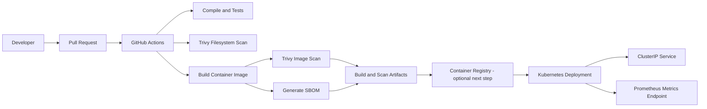

# Secure GitOps Platform
### A security-first Kubernetes delivery blueprint with CI, image scanning, SBOM, runtime hardening, and SRE practices

[](https://github.com/haqueamir70-coder/secure-gitops-platform/actions/workflows/ci.yml)

> Portfolio project demonstrating how to package a Python API, validate it in CI, scan source and container artifacts, generate an SBOM, and deploy with Kubernetes security controls. This is a reference implementation: validate it in your own cluster and cloud before treating it as production-ready.

## Architecture



## What this project demonstrates

- **Application reliability:** health and readiness endpoints plus Prometheus metrics.
- **Container security:** minimal Python base image, non-root runtime, and a Docker health check.
- **Kubernetes hardening:** restricted Pod Security namespace labels, non-root containers, read-only root filesystem, dropped Linux capabilities, resource requests/limits, probes, and disabled service-account token automount.
- **Workload reliability:** two replicas, a PodDisruptionBudget, and a CPU HorizontalPodAutoscaler.
- **Network boundaries:** a namespace-scoped NetworkPolicy example. Adjust allowed peers for your ingress controller, monitoring stack, DNS and cluster CNI.
- **Supply-chain visibility:** CI vulnerability scanning and SBOM artifact generation.
- **SRE operations:** a sample SLO, error-budget explanation, and incident runbook.

## Repository layout

```text
.
├── app/
│   └── main.py
├── docs/
│   ├── incident-runbook.md
│   └── slo-and-error-budget.md
├── k8s/
│   ├── deployment.yaml
│   ├── hpa.yaml
│   ├── kustomization.yaml
│   ├── namespace.yaml
│   ├── network-policy.yaml
│   ├── pdb.yaml
│   └── service.yaml
├── scripts/
│   └── validate.sh
├── .dockerignore
├── .github/workflows/ci.yml
├── Dockerfile
└── requirements.txt
```

## Run locally

Prerequisites: Python 3.12+; Docker is optional for the container steps.

### 1. Start the API

```bash
python -m venv .venv
# Linux/macOS
source .venv/bin/activate
# Windows PowerShell: .venv\\Scripts\\Activate.ps1
pip install -r requirements.txt
uvicorn app.main:app --host 127.0.0.1 --port 8000
```

In another terminal:

```bash
curl -fsS http://127.0.0.1:8000/health
curl -fsS http://127.0.0.1:8000/ready
curl -fsS http://127.0.0.1:8000/metrics
```

Expected health/readiness response: JSON indicating the service is healthy/ready. `/metrics` returns Prometheus text exposition.

### 2. Build and run the container

```bash
docker build -t secure-gitops-platform:local .
docker run --rm -p 8000:8000 secure-gitops-platform:local
```

Then check `http://127.0.0.1:8000/health`.

### 3. Validate Kubernetes manifests

Install `kubectl` and Kustomize (or use a kubectl version that includes `kubectl kustomize`):

```bash
kubectl kustomize k8s
kubectl apply --dry-run=client -k k8s
```

A client-side dry run checks basic manifest processing; it does **not** prove cluster admission, CNI NetworkPolicy enforcement, HPA metrics availability, or successful rollout.

To deploy to a test cluster, build and push the image to a registry you control, update `k8s/deployment.yaml` to the fully qualified image reference, then run:

```bash
kubectl apply -k k8s
kubectl -n secure-gitops-demo rollout status deployment/secure-gitops-api
kubectl -n secure-gitops-demo get deploy,pods,svc,hpa,pdb,networkpolicy
```

The manifests default to a local demonstration image. They will not become pullable on a remote cluster until you push the image and update the image reference. For production, add registry authentication, immutable image digests, TLS ingress, approved NetworkPolicy peers, Pod Security admission checks, and environment-specific secrets/configuration.

## CI pipeline

The GitHub Actions workflow is located at `.github/workflows/ci.yml`. It runs for pushes and pull requests targeting `main` and can also be started manually.

The intended checks are:
1. Python syntax/compile validation and unit tests.
2. Trivy filesystem vulnerability/misconfiguration scan.
3. Container image build and Trivy image scan.
4. SBOM generation and artifact upload.

**A badge or workflow file is not proof of a passing build.** Check the [Actions runs](https://github.com/haqueamir70-coder/secure-gitops-platform/actions) and review the job logs. Scan results may include findings that need triage; do not suppress findings blindly.

## SLO and incident response

- [Sample SLO and error-budget policy](docs/slo-and-error-budget.md)
- [Incident runbook](docs/incident-runbook.md)

The SLO values are illustrative targets for practicing the workflow, not measured service guarantees.

## Security notes

- Never commit credentials, tokens, kubeconfigs, private customer data, or company-internal configuration.
- Run vulnerability scanners and review their output before promoting an image.
- Pin third-party GitHub Actions to full commit SHAs for hardened production workflows.
- Treat this project as a learning/reference blueprint until tests, scans, Kubernetes admission, network behavior, and rollback have been verified in a real environment.

## Roadmap

- [ ] Verify all workflow jobs are green and resolve relevant findings.
- [ ] Publish the image to GHCR using least-privilege workflow permissions.
- [ ] Deploy to a disposable Kubernetes cluster and validate NetworkPolicy behavior.
- [ ] Add integration tests, signed images/provenance, and policy checks.
- [ ] Capture sanitized screenshots or a short demo for the portfolio.

## Author

**MD Amirul Haque** — DevOps / DevSecOps / SRE / Azure Cloud

- GitHub: [haqueamir70-coder](https://github.com/haqueamir70-coder)
- LinkedIn: [MD Amirul Haque](https://www.linkedin.com/in/md-amirul-haque/)

If you find this useful, feedback and issues are welcome.
