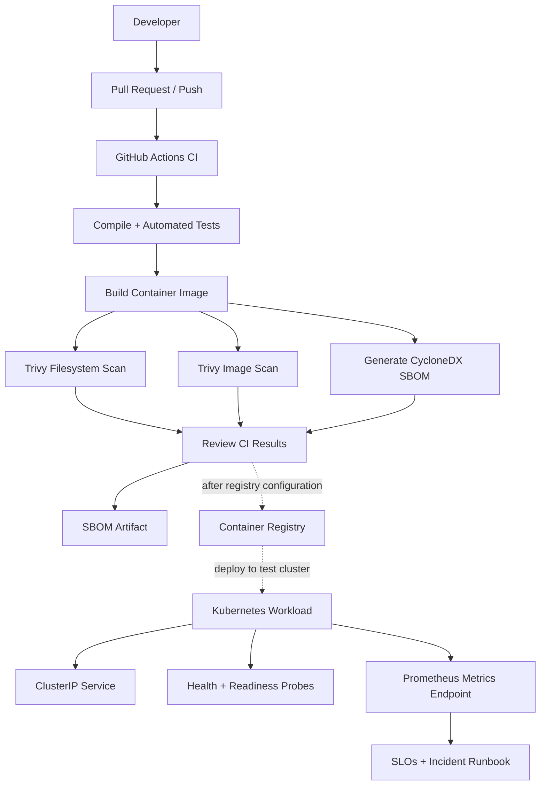

<!--
  Secure GitOps Platform
  Portfolio README | MD Amirul Haque
-->

<div align="center">

# Secure GitOps Platform

### Ship securely. Observe everything. Recover confidently.

**A cloud-native DevSecOps reference platform combining automated testing, container security, Kubernetes hardening, software supply-chain visibility, and SRE operating practices.**

<br/>

[](https://github.com/haqueamir70-coder/secure-gitops-platform/actions/workflows/ci.yml)


<br/>

[Explore the code](https://github.com/haqueamir70-coder/secure-gitops-platform) · [CI pipeline](https://github.com/haqueamir70-coder/secure-gitops-platform/actions) · [Report an issue](https://github.com/haqueamir70-coder/secure-gitops-platform/issues)

</div>

---

## Executive overview

Secure GitOps Platform is a hands-on portfolio project that demonstrates how an engineering team can move from application code to a tested, scanned, containerized workload with Kubernetes security controls and operational guidance.

It brings together **DevOps, DevSecOps, Platform Engineering, Kubernetes, and Site Reliability Engineering (SRE)** in one understandable repository. The emphasis is not just on getting an application to run, but on making delivery repeatable, reducing avoidable risk, and preparing operators to troubleshoot failures.

> **Project status:** The GitHub Actions pipeline has completed successfully for the latest verified run, including tests, container build, Trivy scans, and SBOM generation. Kubernetes manifests and runbooks are included as a deployment blueprint; a live cluster deployment has not yet been verified.

## At a glance

| Area | Implementation |
|---|---|
| Application | FastAPI service with health, readiness, and Prometheus metrics endpoints |
| Quality gates | Python compilation and automated API tests |
| Containerization | Docker image with a non-root runtime user |
| Security checks | Trivy filesystem and container-image scans |
| Supply chain | CycloneDX SBOM generated and uploaded as a workflow artifact |
| Kubernetes | Deployment, ClusterIP Service, HPA, PDB, namespace security labels, NetworkPolicy |
| Reliability | Readiness/liveness probes, resource requests/limits, rollout strategy |
| Operations | Example SLO/error-budget policy and incident runbook |
| Automation | GitHub Actions on pushes and pull requests to `main` |

## Architecture



The registry and cluster deployment are **next-stage integration points**, not an assertion that the workflow currently deploys to a cluster.

## Engineering capabilities demonstrated

<details>
<summary><strong>01 · CI/CD and repeatability</strong></summary>

- Run automated checks consistently on changes to `main` and pull requests.
- Compile the Python source and execute API tests before building the image.
- Build a container artifact in the CI runner.
- Publish the SBOM as a downloadable workflow artifact.
- Review actual job logs rather than treating a badge as proof by itself.

</details>

<details>
<summary><strong>02 · Application and container security</strong></summary>

- Run the API as a non-root user inside the container.
- Keep local virtual environments, Git metadata, and secret-like files out of the Docker build context.
- Scan the repository filesystem and built image with Trivy.
- Generate a CycloneDX software bill of materials to improve dependency visibility.
- Treat scanner output as evidence to triage—not as a blanket guarantee that an image is vulnerability-free.

</details>

<details>
<summary><strong>03 · Kubernetes workload hardening</strong></summary>

The manifests provide examples of:

- Restricted Pod Security Admission labels at namespace level.
- A non-root process and `RuntimeDefault` seccomp profile.
- Read-only root filesystem, disabled privilege escalation, and dropped Linux capabilities.
- CPU/memory requests and limits.
- HTTP liveness and readiness probes.
- Two initial replicas, rolling-update settings, a PodDisruptionBudget, and CPU-based HPA.
- A NetworkPolicy restricting ingress to selected pods in the same namespace.

**Important:** NetworkPolicy enforcement depends on the cluster's CNI. The example policy may need deliberate exceptions for ingress controllers, monitoring, DNS, or other required traffic. Validate it in a disposable cluster before relying on it.

</details>

<details>
<summary><strong>04 · SRE and incident readiness</strong></summary>

- Expose request counters and request-latency histograms for Prometheus scraping.
- Define an illustrative SLI/SLO and error-budget discussion.
- Document a first-response workflow for unhealthy pods, service endpoint problems, blocked network traffic, and HPA issues.
- Include cautious rollout rollback commands and post-incident documentation guidance.

The example SLO is a learning target, **not a measured availability result or contractual SLA**.

</details>

## Repository structure

```text
.
├── .github/
│   └── workflows/
│       └── ci.yml                 # Test, scan, build, and SBOM pipeline
├── app/
│   ├── __init__.py
│   └── main.py                    # FastAPI + Prometheus metrics
├── docs/
│   ├── incident-runbook.md        # Troubleshooting and recovery guide
│   └── slo-and-error-budget.md    # Example SRE policy and PromQL
├── k8s/
│   ├── deployment.yaml            # Hardened workload specification
│   ├── hpa.yaml                   # CPU-based autoscaling example
│   ├── kustomization.yaml
│   ├── namespace.yaml             # Restricted Pod Security labels
│   ├── network-policy.yaml        # Example ingress boundary
│   ├── pdb.yaml                   # Voluntary disruption budget
│   └── service.yaml               # Internal ClusterIP service
├── scripts/
│   └── validate.sh                # Local validation helper
├── tests/
│   └── test_app.py                # API tests
├── .dockerignore
├── Dockerfile
├── requirements.txt
└── README.md
```

## Quick start

### Prerequisites

- Python 3.12 or newer
- Git
- Docker (optional for local container testing)
- `kubectl` and a test Kubernetes cluster (only for cluster validation)

### 1. Clone and run the API

```bash
git clone https://github.com/haqueamir70-coder/secure-gitops-platform.git
cd secure-gitops-platform

python -m venv .venv
```

Activate the environment:

```bash
# Linux / macOS
source .venv/bin/activate

# Windows PowerShell
.venv\Scripts\Activate.ps1
```

Install dependencies, run tests, and start the API:

```bash
python -m pip install -r requirements.txt
pytest -q
uvicorn app.main:app --host 127.0.0.1 --port 8000
```

In a second terminal, verify the endpoints:

```bash
curl -fsS http://127.0.0.1:8000/health
curl -fsS http://127.0.0.1:8000/ready
curl -fsS http://127.0.0.1:8000/metrics
```

- `/health` — process health endpoint
- `/ready` — readiness endpoint
- `/metrics` — Prometheus exposition format

Interactive API documentation is available at `http://127.0.0.1:8000/docs` while the local server is running.

### 2. Build and run the container

```bash
docker build -t secure-gitops-platform:local .
docker run --rm -p 8000:8000 secure-gitops-platform:local
```

Verify `http://127.0.0.1:8000/health`. The image runs as a non-root user. The container health check is useful for local container status; Kubernetes uses its own HTTP probes.

### 3. Render and validate Kubernetes manifests

```bash
kubectl kustomize k8s
kubectl apply --dry-run=client -k k8s
```

These commands validate rendering and client-side manifest processing; they do not prove that admission policies, CNI networking, metrics-server, or rollout behavior work in a real cluster.

### 4. Deploy to a disposable test cluster

Before deployment:

1. Build the image and push it to a registry you control.
2. Update `k8s/deployment.yaml` to use the registry image reference.
3. Configure image-pull access if the registry is private.
4. Review the NetworkPolicy against your cluster's required traffic.
5. Confirm metrics-server is available for HPA operation.

Then deploy and inspect:

```bash
kubectl apply -k k8s
kubectl -n secure-gitops-demo rollout status deployment/secure-gitops-api
kubectl -n secure-gitops-demo get deploy,pods,svc,hpa,pdb,networkpolicy
kubectl -n secure-gitops-demo describe deployment secure-gitops-api
```

The supplied manifest uses `secure-gitops-platform:local` as a demonstration image name. A remote cluster cannot pull that image unless it exists in a reachable registry or has been loaded into the local cluster runtime.

## CI pipeline

Workflow: [`.github/workflows/ci.yml`](.github/workflows/ci.yml)  
Runs: [View GitHub Actions](https://github.com/haqueamir70-coder/secure-gitops-platform/actions)

The workflow is intended to:

1. Check out the repository and configure Python.
2. Install the pinned direct dependencies.
3. Compile the application and test modules.
4. Execute the API test suite.
5. Build the Docker image.
6. Run Trivy filesystem and image scans.
7. Generate a CycloneDX SBOM and upload it as an artifact.

Review the latest run and its logs for the exact result. Scanner jobs are configured to report findings without automatically failing solely on CRITICAL/HIGH findings; a successful run therefore means the checks completed, **not** that every finding is absent or accepted for production.

## SRE practice

Start with these operational references:

- [SLO and error-budget guide](docs/slo-and-error-budget.md)
- [Incident runbook](docs/incident-runbook.md)

Example PromQL queries are included in the SLO guide. Confirm the actual metric names and labels from the running `/metrics` endpoint and configure Prometheus scraping before using them for real operational decisions.

## Roadmap

- [x] Build the FastAPI service and health/metrics endpoints
- [x] Add automated API tests
- [x] Build the non-root container image in CI
- [x] Add Trivy filesystem and image scans
- [x] Generate and upload an SBOM artifact
- [x] Add Kubernetes hardening examples and SRE documentation
- [ ] Publish an immutable image to GHCR with least-privilege workflow permissions
- [ ] Deploy to a disposable Kubernetes cluster and capture rollout evidence
- [ ] Validate NetworkPolicy behavior and HPA scaling under load
- [ ] Add image signing/provenance and policy-as-code checks
- [ ] Add a documented demo with sanitized screenshots and test evidence

## Security and responsible use

- Never commit credentials, access tokens, kubeconfigs, private keys, or confidential employer/customer information.
- Use a disposable environment for first deployment and load tests.
- Review dependency and image scan findings before any release.
- Pin third-party GitHub Actions to full commit SHAs when hardening the workflow for production.
- Add registry authentication, immutable image references, TLS ingress, monitoring access, and environment-specific configuration before real-world adoption.
- Do not treat this reference project as production-ready without security review, cluster validation, recovery testing, and operational ownership.

## About the author

**MD Amirul Haque**  
DevOps · DevSecOps · SRE · Azure Cloud · Platform Engineering

- GitHub: [@haqueamir70-coder](https://github.com/haqueamir70-coder)
- LinkedIn: [MD Amirul Haque](https://www.linkedin.com/in/md-amirul-haque/)

This project is built for hands-on learning and portfolio demonstration. Suggestions and constructive feedback are welcome.

---

<div align="center">

**Secure delivery is not one scan or one pipeline. It is a repeatable engineering practice.**

</div>
