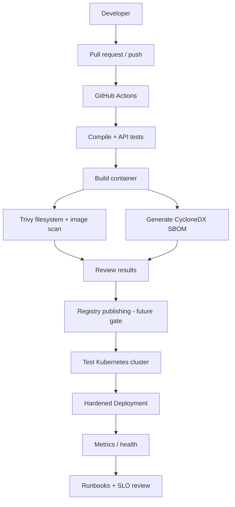

<div align="center">


### Commit to cluster · Policy before runtime · Evidence after release

[](https://github.com/haqueamir70-coder/secure-gitops-platform/actions/workflows/ci.yml)
[](https://www.python.org/)
[](https://fastapi.tiangolo.com/)
[](https://www.docker.com/)
[](https://kubernetes.io/)
[](LICENSE)

**A cloud-native engineering reference that combines tested application delivery, container scanning, SBOM generation, Kubernetes hardening and SRE operating practices.**

[Architecture](#-platform-architecture) · [Quick start](#-quick-start) · [Security controls](#-security-controls) · [Operations](#-sre-and-operations)

</div>

## Executive overview

Secure GitOps Platform demonstrates a delivery path from source code to a tested and scanned container artifact, with Kubernetes manifests and operational guidance for a controlled test-cluster rollout. It connects DevOps, DevSecOps, platform engineering and SRE practices in one repository.

> [!NOTE]
> The GitHub Actions pipeline has a previously verified successful run covering tests, container build, Trivy scans and SBOM generation. The Kubernetes manifests are a deployment blueprint; a live cluster deployment has not yet been verified. Check the current [Actions history](../../actions) for the latest result.

## Platform architecture



Registry publishing and cluster rollout are controlled extension points; the diagram does not claim they are currently automated.

## Capability map

| Layer | Included capability |
|---|---|
| Application | FastAPI health, readiness and Prometheus metrics endpoints |
| Quality | Python compilation and automated API tests |
| Container | Non-root Docker runtime |
| Vulnerability management | Trivy filesystem and image scans |
| Supply chain | CycloneDX SBOM generation and workflow artifact upload |
| Kubernetes | Deployment, Service, HPA, PDB, namespace labels and NetworkPolicy |
| Reliability | Probes, resource requests/limits, rolling update settings |
| Operations | Example SLO/error-budget notes and incident runbook |

## Quick start

### Requirements

- Python 3.12+.
- Git.
- Docker for container testing.
- `kubectl` and a disposable Kubernetes cluster only for cluster validation.

### Run the API locally

```bash
git clone https://github.com/haqueamir70-coder/secure-gitops-platform.git
cd secure-gitops-platform
python -m venv .venv
```

Activate the environment:

```bash
# Linux / macOS
source .venv/bin/activate

# Windows PowerShell
.venv\Scripts\Activate.ps1
```

Install, test and start:

```bash
python -m pip install -r requirements.txt
pytest -q
uvicorn app.main:app --host 127.0.0.1 --port 8000
```

Verify in a second terminal:

```bash
curl -fsS http://127.0.0.1:8000/health
curl -fsS http://127.0.0.1:8000/ready
curl -fsS http://127.0.0.1:8000/metrics
```

Open `http://127.0.0.1:8000/docs` for the interactive API documentation.

### Build the container

```bash
docker build -t secure-gitops-platform:local .
docker run --rm -p 8000:8000 secure-gitops-platform:local
```

## Kubernetes hardening controls

The `k8s/` manifests demonstrate:

- Restricted Pod Security Admission namespace labels.
- Non-root process, read-only root filesystem and disabled privilege escalation.
- Dropped Linux capabilities and `RuntimeDefault` seccomp profile.
- CPU/memory requests and limits.
- Liveness and readiness probes.
- Two initial replicas, rolling-update settings and PodDisruptionBudget.
- CPU-based HPA example.
- NetworkPolicy limiting ingress to selected same-namespace pods.

**CNI dependency:** NetworkPolicy only enforces when the cluster network plugin supports it. Review required ingress-controller, DNS, monitoring and egress flows before applying the sample policy.

## Render and validate manifests

```bash
kubectl kustomize k8s
kubectl apply --dry-run=client -k k8s
```

Client-side dry-run validates manifest processing only. It does not prove admission behavior, CNI enforcement, metrics-server availability or rollout health.

## Deploy to a disposable cluster

1. Build and push the image to a registry accessible by the cluster.
2. Replace the demonstration image reference in `k8s/deployment.yaml`.
3. Configure image-pull credentials if the registry is private.
4. Review NetworkPolicy against actual cluster traffic.
5. Confirm metrics-server is available for HPA.
6. Apply and inspect rollout:

```bash
kubectl apply -k k8s
kubectl -n secure-gitops-demo rollout status deployment/secure-gitops-api
kubectl -n secure-gitops-demo get deploy,pods,svc,hpa,pdb,networkpolicy
```

The sample image name `secure-gitops-platform:local` is not automatically pullable by a remote cluster. Use a reachable registry reference or load it into the cluster runtime.

## CI and software supply chain

Workflow: [`.github/workflows/ci.yml`](.github/workflows/ci.yml)

The workflow compiles and tests the app, builds the container, runs Trivy filesystem/image checks, generates a CycloneDX SBOM and uploads the SBOM as an artifact. Scanner findings are reported for review; a green job must not be interpreted as proof that no vulnerabilities exist.

For a hardened release pipeline, add immutable image digests, provenance, signing, registry publication with least-privilege identity and admission verification.

## SRE and operations

- [SLO and error-budget guide](docs/slo-and-error-budget.md)
- [Incident runbook](docs/incident-runbook.md)

The sample SLO is a learning target, not a measured production SLO or contractual SLA.

## Repository map

```text
.github/workflows/   CI, security scans and SBOM
app/                 FastAPI application and metrics
tests/               API tests
k8s/                 Hardened Kubernetes manifests
docs/                SLO policy and incident runbooks
scripts/             Local validation helper
Dockerfile           Non-root container image
```

## Roadmap

- [x] API health/readiness/metrics endpoints and tests
- [x] Container build and non-root runtime
- [x] Trivy filesystem/image scans and SBOM artifact
- [x] Kubernetes security baseline and SRE documentation
- [ ] Publish immutable image with least-privilege permissions
- [ ] Deploy to a disposable cluster and capture rollout evidence
- [ ] Verify NetworkPolicy and HPA behavior under load
- [ ] Add image signing, provenance and admission verification

## Maintainer

**MD Amirul Haque** · [GitHub](https://github.com/haqueamir70-coder) · [LinkedIn](https://www.linkedin.com/in/md-amirul-haque/)

<sub>Secure the artifact. Constrain the workload. Make operations observable.</sub>
