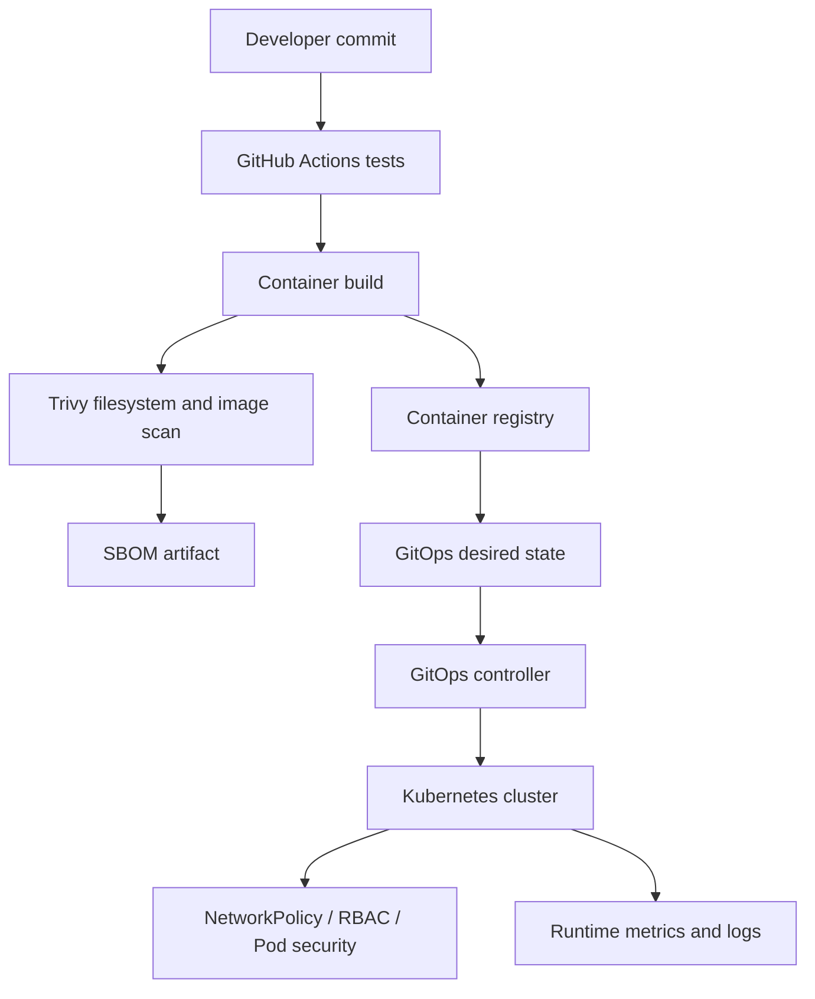

# Secure GitOps delivery platform — Architecture & Interview Guide

Reference delivery path using CI tests, container scanning, SBOM generation, hardened Kubernetes manifests and GitOps reconciliation. Current Trivy exit-code configuration is informational, not a blocking security gate.

## Architecture diagram

## Interview questions

1. 1. What is GitOps and how does reconciliation work?
2. 2. How do push-based and pull-based deployments differ?
3. 3. Why should deployment manifests reference immutable image digests?
4. 4. What is the role of an SBOM?
5. 5. How do Trivy scan exit codes affect pipeline enforcement?
6. 6. How would you roll out a blocking vulnerability policy safely?
7. 7. What controls belong in a hardened Kubernetes Deployment?
8. 8. How do NetworkPolicy and RBAC address different risks?
9. 9. How do you detect and remediate configuration drift?
10. 10. How would you design progressive delivery and rollback?

## Interview preparation note
Answer with architecture rationale, security controls, operational failure scenarios, observability and test evidence. Clearly label implemented, CI-validated, deployed and planned scope.

## Interview questions — suggested answers

### 1. Answer

GitOps stores desired state in Git; a controller continuously compares live state and reconciles drift toward the declared state.

### 2. Answer

Push-based CI deploys to clusters; pull-based GitOps controllers inside the environment fetch desired state, reducing inbound credentials and improving auditability.

### 3. Answer

Tags can be moved; digests identify exact image content. Deploying digests prevents an image from silently changing between validation and runtime.

### 4. Answer

An SBOM inventories components and versions. It supports vulnerability and license analysis but does not prove an artifact is secure or untampered.

### 5. Answer

Trivy exit-code 0 means findings are reported without failing the job. A blocking gate uses non-zero on policy-relevant findings after exceptions are triaged.

### 6. Answer

Baseline findings, define severity/exception policy, remediate critical issues, run in report-only mode, then enable blocking by severity with time-bounded waivers.

### 7. Answer

Use non-root, read-only filesystem, dropped capabilities, resource requests/limits, seccomp, restricted service accounts, probes and image digest pinning.

### 8. Answer

NetworkPolicy restricts pod network flows; RBAC controls Kubernetes API actions by users/service accounts. Both are needed for different attack surfaces.

### 9. Answer

GitOps reports drift and reconciles it. For legitimate changes, update Git; for emergency changes, document break-glass use and reconcile desired state promptly.

### 10. Answer

Use health checks, progressive delivery, readiness gates, metrics and automated rollback. Test failure scenarios in a disposable cluster before production.

## Complete zero-to-hero guide

See [ZERO-TO-HERO.md](./ZERO-TO-HERO.md) for the business scenario, architecture walkthrough, tool-by-tool explanations, implementation sequence, practical commands, troubleshooting playbook and additional scenario-based interview questions with answers.
