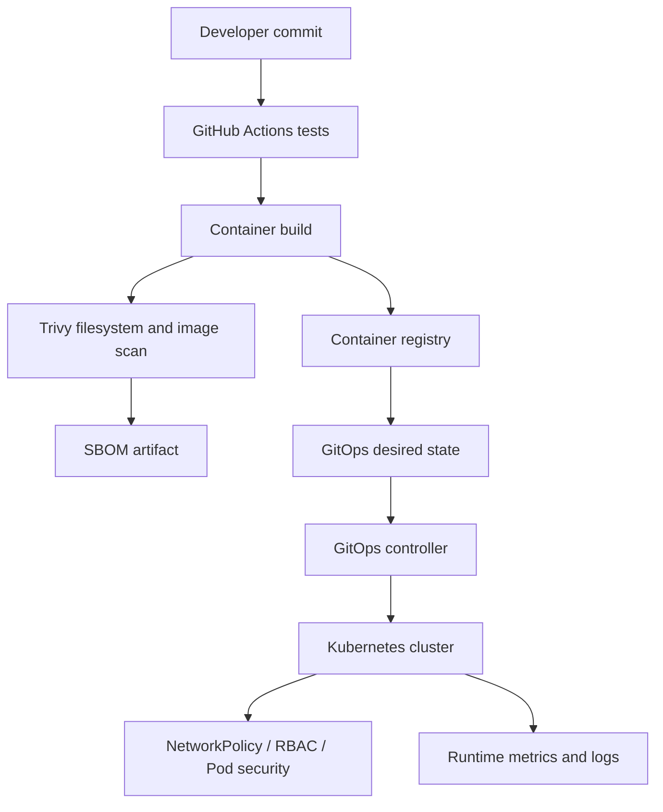

# Secure GitOps delivery platform — Architecture & Interview Guide

Reference delivery path using CI tests, container scanning, SBOM generation, hardened Kubernetes manifests and GitOps reconciliation. Current Trivy exit-code configuration is informational, not a blocking security gate.

## Architecture diagram

## Interview questions

1. 1. What is GitOps and how does reconciliation work?
2. 2. How do push-based and pull-based deployments differ?
3. 3. Why should deployment manifests reference immutable image digests?
4. 4. What is the role of an SBOM?
5. 5. How do Trivy scan exit codes affect pipeline enforcement?
6. 6. How would you roll out a blocking vulnerability policy safely?
7. 7. What controls belong in a hardened Kubernetes Deployment?
8. 8. How do NetworkPolicy and RBAC address different risks?
9. 9. How do you detect and remediate configuration drift?
10. 10. How would you design progressive delivery and rollback?

## Interview preparation note
Answer with architecture rationale, security controls, operational failure scenarios, observability and test evidence. Clearly label implemented, CI-validated, deployed and planned scope.
